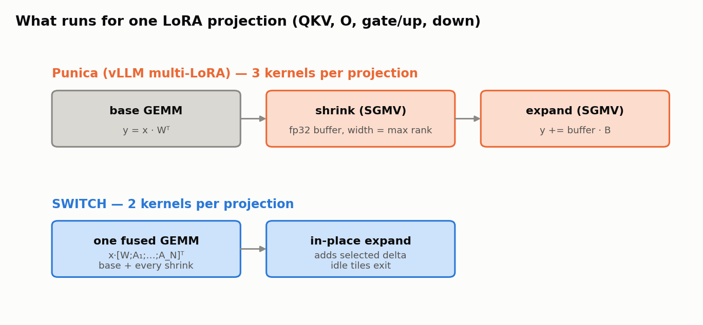
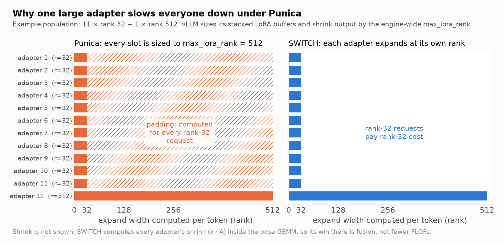
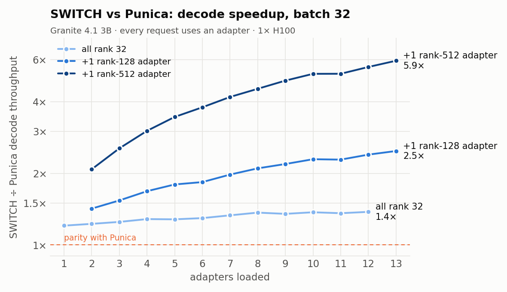
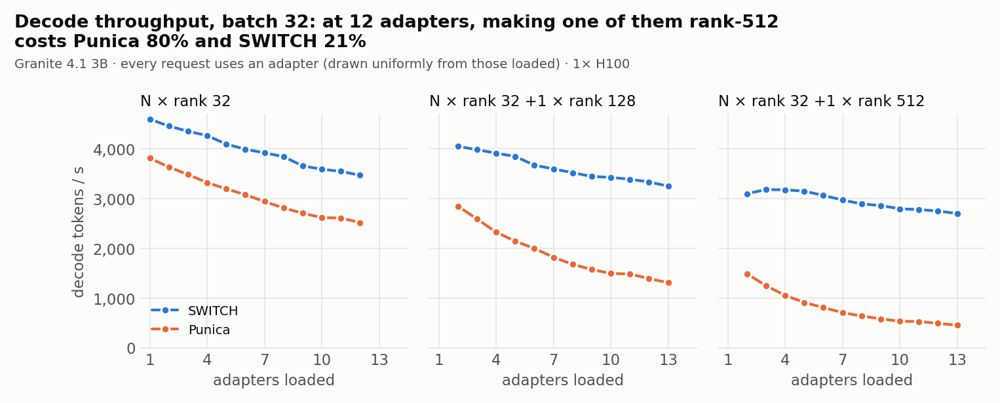
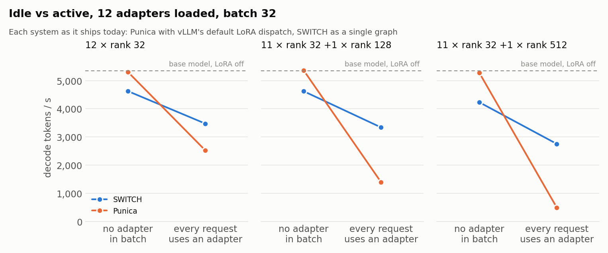

# Introducing the SWITCH kernels: Faster serving of Multiple Low Rank Adapters

**TL;DR.** We developed the SWITCH kernels: a fused base+shrink GEMM plus a Triton expand kernel that replaces
vLLM's three-launch Punica LoRA path inside [Granite Switch](https://github.com/generative-computing/granite-switch). On Granite 4.1
3B at batch 32, SWITCH decodes **1.2–1.4× faster** than Punica when every adapter has the same
rank. When the ranks are mixed it is **up to 2.5× faster** with one rank-128 adapter among
rank-32 ones, and **up to 5.9× faster** with one rank-512 adapter. At idle (no adapter) vLLM+SWITCH is slightly slower than vLLM's raw performance.

## Motivation and Availability

As part of our mission to create a modular model architecture where adapter libraries are used to enhance
a model, we encountered the problem that existing infrastructure for serving adapters introduced
unnecessary performance overheads. These overheads are noticeable even when a single adapter, regardless of
its size, is introduced, but become very pronounced when the adapters have diverse sizes, which we anticipate will be a common
scenario when a developer is integrating library components from different contributors into a single checkpoint.

In order to address these performance problems, we took a careful look at how conventional technology for serving
LoRA adapters (for example, Punica kernels) operates, and developed alternate kernels that address the weaknesses
revealed by our analysis.

The outcome is a set of kernels that offer superior performance in all settings where adapters are being used in a batch, for both prefill and decode throughput. When the collection of adapters has diversity in their ranks, the speedups become very significant.

These kernels, which we've named the "SWITCH kernels", are currently available for Granite Switch's vLLM backend. The backend supports tensor parallelism; the numbers in this post are single-GPU (TP=1). It is currently not a drop-in replacement for vLLM's LoRA path on other architectures. These kernels will speed up conventional LoRA technology, but also IBM's activated LoRA technology which allows more flexible adaptation within a single generation trace.


## The setting: adapters that change mid-sequence

The fundamental Granite Switch architecture differs from conventional models in that the decisions of what adapter to apply to any given token in a batch are detected within the model itself in its "switch" layer. Thus one requirement for the SWITCH kernels is that they have good performance in this setting; in general though, we anticipate that if implemented under the conventional settings where at dispatch time, the inference engine knows which adapters will be applied to each token, the speedups that we describe herein will directly carry over.

vLLM's multi-LoRA support, built on the Punica SGMV kernels, was designed for the classic case
where each request names its adapter up front and keeps it for the whole request. It is very
good at that, and Granite Switch originally used it. But two of its design choices get
expensive in our setting.

## What SWITCH does differently

SWITCH is named after its design: **S**witched delta, **W**-ext fusion, **I**n-place,
**T**iled, **C**onditional skip, **H**eterogeneous rank.

Existing Punica technology, as implemented in vLLM, exhibits the following properties:

**1. Three launches per projection.** For each LoRA-wrapped linear layer (QKV, O, gate/up,
down), Punica runs the base GEMM, then a *shrink* (`x · A`) into an fp32 buffer, then an
*expand* (`buffer · B`) added into the output. At decode batch sizes these kernels are small,
and every launch carries a fixed cost.

**2. Every adapter slot is sized to the largest rank.** vLLM allocates its stacked LoRA
weights and the shrink buffer using one engine-wide `max_lora_rank`. Load a single rank-512
adapter next to eleven rank-32 ones and every request is computed at rank-512 width, including
the ~92% of requests that only need rank 32.

The two major design decisions that power their advantage are illustrated below, shown as a contrast with the way Punica SGMV kernels are currently implemented in vLLM:





Specifically,

- **One fused GEMM for the base and every shrink.** When the model loads, we stack the base
  weight `W` with every adapter's `A` rows into a single matrix `w_ext = [W ; A₁ ; … ; A_N]`.
  One dense GEMM, `x · w_extᵀ`, then gives the base output and all the shrink vectors at
  once. We compute every adapter's shrink for every token, so this is not fewer FLOPs. It is
  one large, tensor-core-friendly GEMM in place of a separate gather-based shrink launch. This design decision stems from the observation that launch overheads tend to dominate performance whereas modern GPU hardware and GEMM kernels have strong performance.
- **An in-place, switched expand.** A second Triton kernel reads each token's selected shrink
  columns, multiplies by that adapter's `B` and adds the result *in place* into the base
  output. Each token has exactly one adapter, and the base and shrink columns don't overlap,
  so no atomics or scratch buffers are needed.
- **Conditional skip.** Each tile of tokens checks a per-module bitmask of which adapters it
  contains. A tile with no adapter exits immediately. This is a design pattern also present in the vLLM Punica kernels, but here it is extended to effectively deal with diverse ranks in an adapter.
- **Per-adapter rank tiers.** Adapters are grouped into rank tiers (16 … 512), and each
  adapter's expand runs at its own rank. A rank-512 adapter costs rank-512 work only for the
  tokens that use it.


## Results

All numbers are Granite 4.1 3B decode on 1× H100 (TP=1, bf16) with batch 32. In every run,
each request uses an adapter drawn uniformly from those loaded. Methodology is at the end.

### Balanced ranks: already faster



With every adapter at rank 32 (the bottom line), SWITCH is **1.21× faster with one adapter
and 1.38× faster with twelve**, so the lead grows as more adapters are loaded.

### Imbalanced ranks: much faster

The upper two lines keep the rank-32 adapters and add **one** larger adapter. Under Punica,
that one adapter raises `max_lora_rank` for the whole engine. With a rank-128 adapter, SWITCH's
lead grows to **2.5×**; with a rank-512 adapter, to **5.9×** (13 adapters loaded).



Absolute throughput shows where the gap comes from. At 12 adapters, replacing one rank-32
adapter with a rank-512 one cuts Punica's throughput by **80%** (2,521 → 493 tok/s). SWITCH
loses **21%** (3,472 → 2,753 tok/s): requests that hit the rank-512 adapter pay for it, and
the other requests mostly don't.

## What happens when no adapter is active

A fair comparison also has to cover the case where *no* request in the batch is using an
adapter. The figure below compares each system **as it currently implemented**: Punica with vLLM's multiple CUDA graph dispatch, with a specialized graph for the no-adapter case, and  SWITCH as a single graph.



Of note is that the overhead at idle that the SWITCH implementation in Granite Switch and vLLM exhibit is unrelated to the SWITCH kernels themselves, and rather
related to the fact that SWITCH is operating as a single computational graph, whereas vLLM does not run an adapter specific graph when no adapters are present. It would be relatively
straightforward to implement SWITCH with two graphs, in which case the performance in the no adapter case would match vLLM/Punica exactly. As indicated earlier, we are currently focused in the setting where the model discovers which adapters need to be applied to which tokens through its switch layer, and currently there is no support in vLLM for adapting the computational graph once the model is already invoked.

## Prefill and 8B, briefly

- **Prefill (3B).** With every sequence using an adapter, SWITCH's prefill throughput beats
  Punica by **+14–22%** with balanced ranks (batch 8, 512- and 2,048-token prompts),
  **+19–46%** with one rank-128 adapter, and **+29–154%** with one rank-512 adapter. With no
  adapter active, prefill shows the same single-graph gap as decode.
- **8B decode.** The same pattern holds but with smaller margins. At batch 32, SWITCH leads
  by **1.11–1.32×** with balanced ranks and **1.26–1.99×** with one rank-128 adapter; the
  no-adapter gap is 5–10%. We did not run the rank-512 population at 8B. 8B prefill with
  adapters active (batch 8) is **+9–15%** (balanced) and **+10–24%** (one rank-128 adapter).

## Methodology

- **Hardware and software.** 1× NVIDIA H100, TP=1, bf16, vLLM 0.22.1, CUDA graphs on
  (`enforce_eager=False`, `max_cudagraph_capture_size=1024`).
- **SWITCH arm.** Granite Switch checkpoints composed with N adapters, using the SWITCH
  kernel backend.
- **Punica arm.** The same base model in stock vLLM with `enable_lora=True`, one
  `LoRARequest` per adapter, `max_loras = N` and `max_lora_rank` set to the largest adapter's
  rank.
- **Inputs.** Byte-identical prompts and per-prompt adapter assignments across arms, drawn
  from a fixed-seed RNG; adapters drawn uniformly from those loaded. Decode: 512-token
  prompts, 128 generated tokens.
- **Timing.** 5 measured runs after 2 warmups per cell; we report the median.
- **Populations.** *Balanced*: N × rank 32. *Imbalanced*: N × rank 32 plus 1 × rank 128 or
  1 × rank 512 (N + 1 adapters loaded).
- **Base reference.** The "LoRA off" line in the idle figure is the plain 3B base model with
  LoRA disabled, measured in a separate session.

## Try it

SWITCH is the default vLLM kernel backend in Granite Switch. Compose a checkpoint and serve it
with vLLM:

```bash
python -m granite_switch.composer.compose_granite_switch \
  --adapters ibm-granite/granitelib-rag-r1.0 --output ./my-granite-switch

python -m vllm.entrypoints.openai.api_server --model ./my-granite-switch --port 8000
```

<!-- TODO: link the repo's SWITCH design doc once it is on main, and confirm the install line. -->
